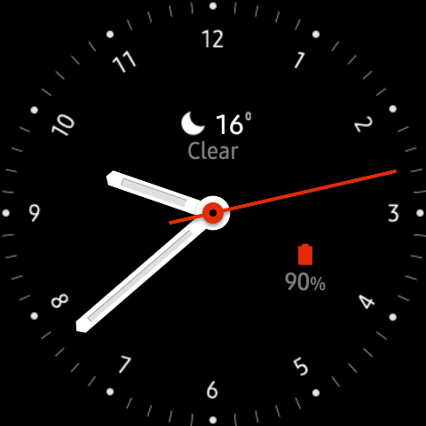
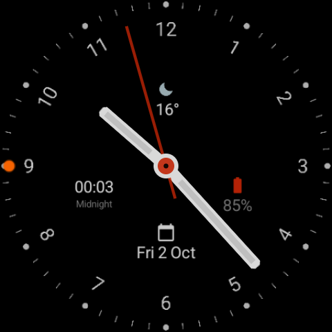

# Analog Plus — Wear OS watch face

A Wear OS watch face that looks like Samsung's stock analog face, with **four** complication slots
instead of two, and every slot hideable. It is a code-free
[Watch Face Format](https://developer.android.com/training/wearables/wff) v3 app: XML plus PNG
images, no Kotlin or Java.

| Original (reference) | This face on the Galaxy Watch |
|---|---|
|  |  |

## Complication slots

| Slot | Default | If that provider is missing |
|---|---|---|
| Top | Samsung Weather (`com.samsung.android.watch.weather`) | Empty |
| Right | Watch battery (system provider) | always available |
| Left | Next prayer from the `com.seyedjafari.prayertimes` Wear app | Empty (blank, no error) |
| Bottom | Step count (system provider) | always available |

Weather: Samsung's weather complication exists on the watch, so it is the top slot's default. On a
watch without it, pick weather once in the editor.

**Hide a slot:** long-press the face, tap *Customize*, pick the slot, choose *Empty*. An empty slot
draws nothing. With all four empty the face is a plain analog dial. Defaults are only starting points:
any slot can show any provider (short text, ranged value, icon, small image).

**Always-on mode:** the dial and hands dim, the second hand is hidden, and the complications stay
visible, dimmed. The red centre disc is drawn unchanged.

## Requirements

Wear OS 5.1 (API 35) or later, because auto-sizing complication text needs Watch Face Format v3.
Package: `com.seyedjafari.analogwatchface`.

## Build and install

```bash
pip3 install -r requirements.txt     # Pillow, for the image generator only
./gradlew :app:assembleDebug        # app/build/outputs/apk/debug/app-debug.apk
scripts/install.sh <adb-serial>      # build, install, activate (emulators)
```

On a real Samsung watch the activation broadcast is ignored: after installing, long-press the
current face and pick *Analog Plus*. Pair the watch for installs with Wireless debugging, as described
in the `prayertime-widgets` README. Note that `adb install -r` keeps the saved complication choices:
run `adb uninstall com.seyedjafari.analogwatchface` first to see a variant's real defaults.

## Builder POC

A proof of concept for a paid builder app: a phone editor (free colours, movable complication slots, ring
complications) builds and signs a face and pushes it to a Wear OS 6 watch with Watch Face Push. It lives in
`facegen/`, `packjni/`, `protocol/`, `phone/` and `watch/` and does not change the face above. Install, usage, known
limits, the real-device checklist and the emulator end-to-end run (`scripts/poc_e2e.sh`, screenshots in
`docs/screenshots/poc/`) are in [`docs/poc/README.md`](docs/poc/README.md).

Building the modules that use the native packer (`:phone:`, `:facegen:`, `:packjni:`, or a bare `./gradlew assembleDebug`,
which builds every module; `:watch:` and `:protocol:` do not) needs Rust, `cargo-ndk`, Android NDK 28.2 and network for the first build; see
[`docs/poc/pack-native.md`](docs/poc/pack-native.md). The face build above is unchanged: `:app:assembleDebug` and
`:app:assembleRelease` (also used by `scripts/install.sh` and the CI workflows) never touch Rust.

## Changing the design

All geometry lives in two generators, so images and XML cannot drift apart:

- `tools/gen_assets.py`: dial and hand PNGs (measured from `docs/reference/original-watchface.png`).
- `tools/build_face.py`: `app/src/main/res/raw/watchface.xml`. Slot boxes are in the face's
  450 x 450 space; `--all-empty` writes a variant with every default removed.

After editing, run both generators, then `python3 -m unittest discover -s tests` and
`scripts/validate.sh` (Google's `wff-validator`, downloaded into `tools/bin` on first use).

## Emulator matrix

`scripts/create_avds.sh` creates small round, square and rectangular Wear OS 6 AVDs next to the
existing `GalaxyWatch7_API36` (large round). `scripts/avd_shot.sh <avd> <even-port>` boots one
headless, installs the face and saves `docs/screenshots/<avd>.png`. The committed captures also
include `all-slots-hidden.png` and `ambient.png`.

## CI and releases

`.github/workflows/ci.yml` runs the tests, the format validator and a debug build on every push and
pull request to `main`. Pushing a tag such as `v1.0.0` runs `release.yml`, which publishes a GitHub
Release with `AnalogPlus-debug.apk`, plus `AnalogPlus-release.apk` when the signing secrets
(`KEYSTORE_BASE64`, `KEYSTORE_PASSWORD`, `KEY_ALIAS`, `KEY_PASSWORD`) are set.
